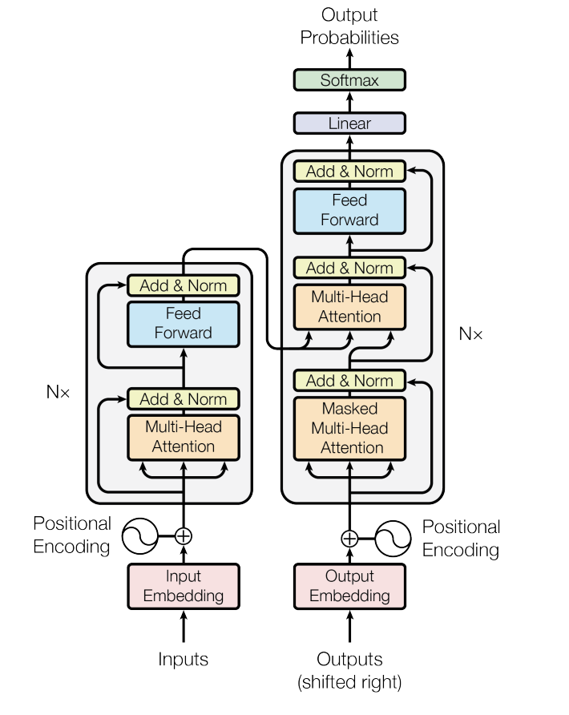

# 模型的输入输出过程理解

> 知识主题：Transformer
> 所属领域：GPU
> 学习日期：2026/11/3
> 最后更新：2026/11/3

## 1. 核心理解

一串输入丢给大模型，大模型依次输出预测的下一个字符，本次就来整理一下这个过程。
它主要分为两个阶段，分别是 `Prefill` 和 `Decode`。
- Prefill
这个阶段处理输入的内容，完成向量化，KV Cache计算等
- Decode
这个阶段基于输入的最后一个token，开始预测下一个token，直到结束

如下图，左边是Prefill，右边数Decode阶段，下面分着两个部分讲解。
{: width="50%" }

## 2. Prefill

### 2.1 向量化
第一步就是把输入的文字转换为计算机或者模型能过识别的一串向量。
那具体是怎么实现的呢？
每个模型都有一个向量词库，叫`vocab.json` ,可以去 [modelscope](https://www.modelscope.cn/models/Qwen/Qwen2.5-1.5B-Instruct/file/view/master/vocab.json) 任选一个模型查看。
这个词库对于qwen模型大约15万个，里面的内容是一个key，value格式。一个token对于一个编号，这个编号就是我们说的token id，模型基于这个token id去获取对应token id的embedding 高纬度矩阵。

#### 2.1.1 分词
模型首先做的第一步是把输入的文字转换为一个一个词语，这里的词语就是token。但是分词完还是人类能识别的语言，还要把token转换为token id。正常模型一个函数就完成了分词和token id的转换。

```python
text = "中国的首都是"
tokens = tokenizer.tokenize(text)
print(tokens)
print(f"Token 数量: {len(tokens)}\n")
```
这样输出的结果是
```python
['ä¸ŃåĽ½çļĦ', 'é¦ĸ', 'éĥ½æĺ¯']
Token 数量: 3
```
如结果所示，分词器把输入分成了3个token，这3个token可以去vocab文件中搜索，是可以发现的
有了token之后，模型就会去vocab文件中去取它对应的序号

```python
tokenizer.convert_tokens_to_ids(tokens)
```

这样输出的结果是
```python
[105538, 59975, 100132]
```
这一串数字就是3个分词对应的token id。 
那如果想把数字代表的含义得到，可以用如下的代码

```python 
tokenizer.decode(token_ids[0])
```
这样输出的结果是
```python
中国的
```

到这里，我们可以明白，输入一串文字后，首先`tokenizer` 需要`分词`，把输入切块得到token；这一步完成后，需要把`token` 查询vocab得到`tokenid`,拿到下一步之后，就要***基于这个id去取对应的向量矩阵***了。

> 这里可以思考一下，为什么vocab不是直接的明文，而是编码后的？这个文件是穷举了所有的可能性吗？如果碰到不在vocab里面的词怎么办？


#### 2.1.2 向量化
在模型中，有两个概念需要了解
- vocab_size：这个代表模型的词表大小，这个和token一一对应，比如当前模型是151936
- hidden_size：模型的维度，当前模型是1536

那么可以认为在模型参数里面有一个151936行，每一行1536列的一个矩阵。每一行都代表一个token的矩阵。
所谓的向量化，就是基于这个token id去这个矩阵中取出这一*token id* 行的hidden_size维度的矩阵来去给到模型。

那我们又可以得到一个结论，对于同一个模型，不同用户输入的同一个token，其实得到的输入矩阵是一样的。

```python
first_token_id = input_ids[0, 0].item()  # 拿到第 1 个 token 的 ID（即 '中国' 的 ID）
vector_from_table = embed_layer.weight[first_token_id]  # 直接从权重矩阵取对应行
```
得到的结果如下
```python
tensor([ 0.0654, -0.0154,  0.0442,  ...,  0.0149,  0.0179, -0.0164],
       device='cuda:0', dtype=torch.bfloat16, grad_fn=<SelectBackward0>)
torch.Size([1536])
```
对于第一个token id，拿到了一个1536维度的矩阵，并且这个矩阵打印出来就是这样的一个浮点数矩阵。

所以我们的输入是3个tokens，那么，对于这一次的模型对话，模型的输入其实是3个维度是1536的矩阵在一起。这样的方式可以表达成这样`[3,1536]`的输入矩阵。
对于一次输入来说，是3个1536维度的矩阵，还可以表示成这样`[1,3,1536]`。

至此，我们完成了大模型的第一步，输入向量化。

> 向量化之后，正常会有一个归一化的操作，防止获取到的向量数据差别过大
> todo : 补充

### 2.2 位置编码
这里我们思考如下的两个输入，对于模型有什么区别

```python
text1 = "猫捉老鼠"
text2 = "老鼠捉猫"
print(tokenizer.tokenize(text1))
print(tokenizer.tokenize(text2))
```
得到的结果是
```PYTHON
['çĮ«', 'æįī', 'èĢģé¼ł']
['èĢģé¼ł', 'æįī', 'çĮ«']
```
我们可以看到得到的token都是 猫 / 捉 / 老鼠，人脑知道这两个不一样，是应为我们知道这个先后关系，但是对于模型来说，它是不知道的。

从数学的角度看，如下自注意力计算的公式是Q和K做点积，之后做加权求和。所以对于最后一个token来说，老鼠是第一个还是第五个token，对于最后的加权求和其实不影响。

那么这个位置信息就要在做注意力分数之前就要处理完成。

$$\text{Attention}(Q, K, V) = \text{softmax}\left(\frac{QK^T}{\sqrt{d_k}}\right)V$$

所以对于模型的输入来说，还需要提供给模型token的位置关系信息

#### 2.2.1 QKV矩阵
在处理位置信息之前，我们回顾一下，现在我们有什么。

我们有输入的token对应的`[3,1536]` 矩阵，接下来，模型的重要角色 QKV就会登场。

模型训练完成之后，每一层都会有固定的三个矩阵，矩阵分别是
$$W_Q, W_K, W_V \in \mathbb{R}^{d_{\text{model}} \times d_{\text{model}}}$$
这是和模型维度相关的矩阵，这三个的维度都是`[hidden_size,hidden_size]`

我们输入的是3个 `[1,1536]`的矩阵，为例方便表示，我们取一个叫X吧

这3个矩阵，分别乘如上的 W_Q, W_K, W_V 三个矩阵
$$Q = XW_Q, \quad K = XW_K, \quad V = XW_V$$

这样对于输入X的矩阵维度是[1,1536]，W矩阵是[1536,1536],这两个点积之后得到的三个QKV向量也是 [1,1536]矩阵

这里大概理解一下QKV代表什么含义
+ Q：代表这个输入的token，需要获取什么信息
+ K：代表这个输入的token的标签是什么
+ V：代表这个输入的token真正有的内容是什么

这三个向量是输入决定之后，这3个向量就决定了。

那回过头来，我没看transformer的函数，是Q K做点积，V最后只是用来累加的。所以我们要继续位置编码的话题

#### 2.2.2 位置编码
如上，一个输入embedding矩阵会变成三个QKV矩阵，这里没的QK矩阵，需要记录位置信息。

当前流行的做法是`RoPE`  旋转位置编码

我的理解就是每个输入的token都是有位置编码的，0，1，2，3...这样。每个位置编码的token会旋转对应的角度，去记录位置信息。这里的i就是刚说的位置序号，d就是模型的hiddensize

$$ θ_i = 10000^(-2i/d) $$


这里是通过三角函数的旋转得到的位置编码，有了位置编码后，我们就得到了新的Q，K，已经之前的V。这样，我们就可以进入传说中的transformer了。


## 3. 核心技术细节

记录真正重要的技术内容。

- 核心概念：
- 关键参数：
- 重要机制：
- 相关组件：

## 4. 实际应用

记录实际操作和验证过程。

### 环境

### 操作命令

### 实验结果

### 结果分析

## 5. 知识关联

这个知识点与哪些其他技术有关？

- 上游知识：
- 下游知识：
- 相关技术：

## 6. 容易混淆的地方

记录容易记错、理解错误的地方。

## 7. 主动回忆（不看资料回答）

1.
2.
3.
4.
5.

## 8. 当前尚未解决的问题

记录自己还不理解的内容。

- [ ] 
- [ ] 

## 9. 掌握程度

- [ ] 只看过，尚未理解
- [ ] 能够理解，但不能独立解释
- [ ] 能够独立解释
- [ ] 能够实际操作
- [ ] 能够独立排障和应用

## 10. 复习记录

| 日期 | 复习结果 | 遗忘内容 | 下一步 |
|---|---|---|---|
| | | | |
